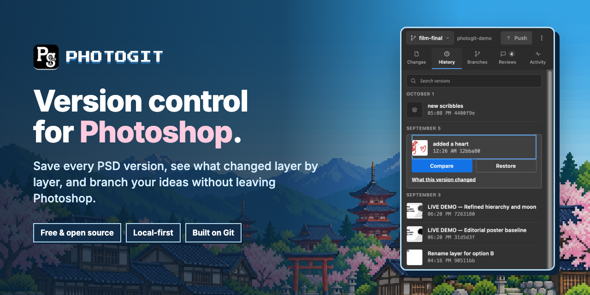
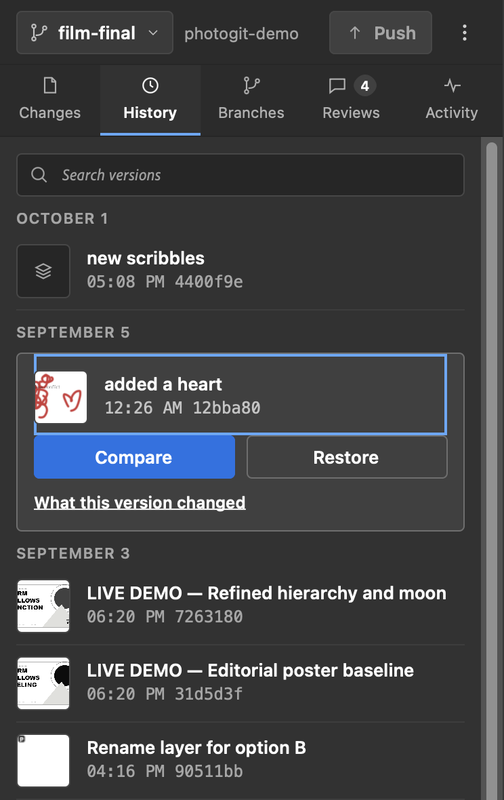
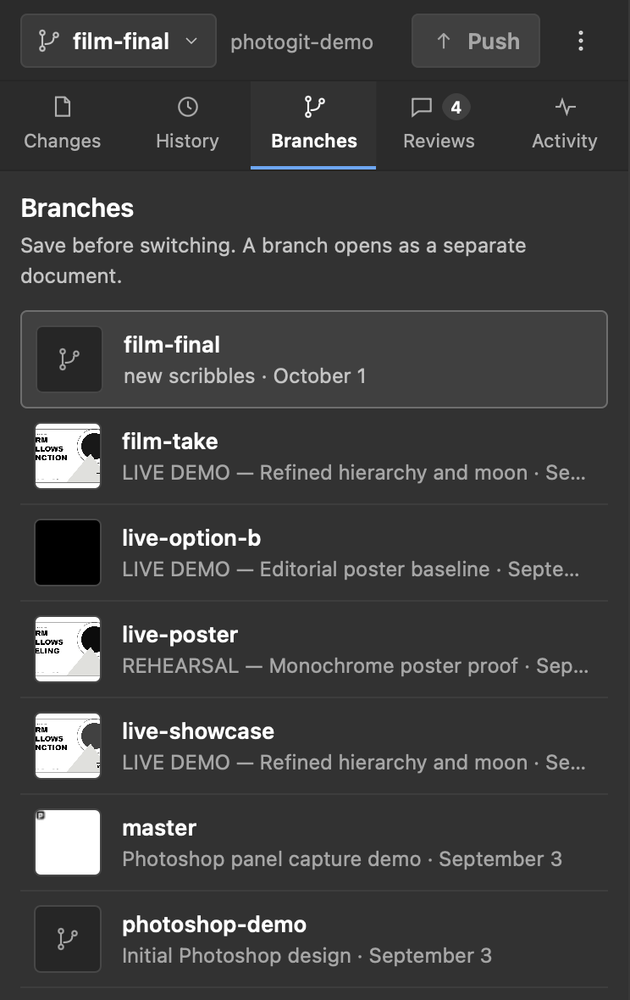
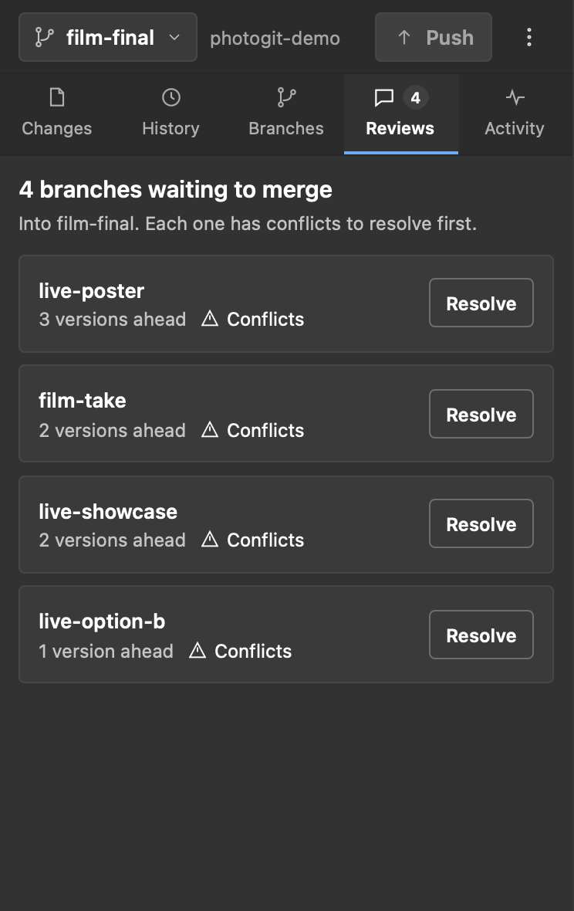

<div align="center">

<a href="https://photogit-three.vercel.app/"></a>

<h3>Version control for Photoshop.</h3>

Save exact PSD versions, see what changed layer by layer, and branch your ideas,<br>all from a panel inside Photoshop. Free, open source and local-first.

[](https://github.com/xingexu/photogit/stargazers)
[](https://github.com/xingexu/photogit/actions/workflows/ci.yml)
[](LICENSE)
[](docs/COMPATIBILITY.md)
[](CONTRIBUTING.md)

**[Website](https://photogit-three.vercel.app/)** · **[Quick start](#-quick-start)** · [Setup guide](docs/QUICK_START.md) · [Commands](docs/COMMANDS.md) · [Architecture](docs/ARCHITECTURE.md) · [Changelog](CHANGELOG.md)

</div>

> [!NOTE]
> PhotoGit is an early **0.2 development build**: it works end to end on macOS with Photoshop 2026, but keep independent backups of valuable artwork. ⭐ **Star the repo** to follow along. It's the best way to help more designers find it.

## Why PhotoGit?

Photoshop users still version their work with **Save As**: `poster_final.psd`, `poster_final_v2.psd`, `poster_final_v3_REAL_use-this.psd`. Copies pile up, nobody can tell what changed between them, and trying a bold idea means duplicating the whole file.

The design version-control tools that exist were built for Sketch and Figma. Plain Git with LFS stores PSDs fine, but sees them as opaque blobs and lives in a terminal. **PhotoGit puts Git's safety net inside Photoshop, and it understands layers.**

## The panel

<table>
  <tr>
    <td width="33%"></td>
    <td width="33%"></td>
    <td width="33%"></td>
  </tr>
  <tr>
    <td align="center"><b>History</b><br>Every saved version, with a preview. Compare any of them with the open document, or restore it as a separate copy.</td>
    <td align="center"><b>Branches</b><br>Try an alternative without losing the original. Each branch shows the last version saved on it.</td>
    <td align="center"><b>Reviews</b><br>See which branches are ready to merge and which have conflicts to settle first.</td>
  </tr>
</table>

## Features

- 🧱 **Layer-by-layer changes.** The Changes tab lists unsaved edits by layer: pixels, text, opacity, blend mode, order, effects, masks and more.
- 💾 **Exact PSD versions.** Each version stores the full PSD alongside a readable description of every layer, so you can always reopen precisely what you saved.
- 🔍 **Before / after compare.** History shows previews, comparisons, and which layers were added, deleted or edited.
- 🌿 **Branches for big ideas.** Explore a direction on a branch and merge it back. Conflicting PSD edits are blocked, never silently overwritten.
- 🔒 **Local and private.** Your artwork stays in a folder on your machine. Nothing leaves it unless you push to a remote you choose.
- 🐙 **Real Git underneath.** Every version is a Git commit, so GitHub, backups and your existing tools work as usual.
- ⌨️ **Command palette.** Press <kbd>/</kbd> or <kbd>⌘</kbd><kbd>K</kbd> to scan, save, branch, compare and merge from the keyboard.

### How it compares

| | "Save As" copies | Plain Git + LFS | **PhotoGit** |
| --- | :---: | :---: | :---: |
| Reopen any exact past PSD | ✅ | ✅ | ✅ |
| See which layers changed | ❌ | ❌ | ✅ |
| Visual before / after compare | manual | ❌ | ✅ |
| Branch ideas without duplicate files | ❌ | ✅ | ✅ |
| Works inside Photoshop | ✅ | ❌ | ✅ |
| No command line day to day | ✅ | ❌ | ✅ |
| Sync to GitHub or any Git remote | ❌ | ✅ | ✅ |

## 🚀 Quick start

**You need:** macOS, Photoshop 25 (2024) or later, Node.js 22+, Git 2.40+ with Git LFS, and Adobe UXP Developer Tools. Windows is not verified yet ([compatibility](docs/COMPATIBILITY.md)).

**1. Install PhotoGit**

```sh
git clone https://github.com/xingexu/photogit.git
cd photogit
npm ci && npm run build
```

**2. Create a project for your artwork and start the helper**

```sh
npm run photogit -- init /absolute/path/to/design-project
npm run helper -- --approve-root /absolute/path/to/design-project
```

Keep the helper running. It's the only process that runs Git; the panel talks to it over a paired, Git-ignored bridge.

**3. Open the panel in Photoshop**

Load `apps/photoshop-plugin/manifest.json` in UXP Developer Tools, then choose **Plugins → PhotoGit → PhotoGit**. Pick your project folder, connect your document, and save your first version.

That's the only time you need the terminal. Pairing, Git identity and troubleshooting are in the [setup guide](docs/QUICK_START.md). Want a look first? Open `apps/photoshop-plugin/demo.html` for a simulated panel.

### Daily workflow (entirely in the panel)

- **Changes**: scan edits and save a named version
- **History**: inspect versions and open saved PSDs as separate documents
- **Branches & Reviews**: explore alternatives, compare changes, and merge when safe
- **Commands & Docs**: drive everything from a fixed command dispatcher (never arbitrary code), and browse the [command directory](docs/COMMANDS.md)

## How it works

PhotoGit serializes your Photoshop document into a domain-split JSON tree under `.photogit/`, instead of versioning the raw PSD as one opaque blob:

| File | Contents | Panel filter |
| --- | --- | --- |
| `document.json` | Canvas size, resolution, color mode, compatibility warnings | — |
| `structure/layers.json` | Layer tree — names, order, parent/child relationships, kind | Structure |
| `appearance/<layer>.json` | Visibility, opacity, blend mode, locks, bounds (one file per layer) | Visual |
| `text/<layer>.json` | Text contents and style fingerprint (text layers only) | Text |
| `content/<layer>.json` | Pixel/raster content fingerprint (one file per layer) | Visual |
| `identities.json` | Tracks each layer's identity across renames/reorders, with a confidence score | — |
| `project.json` | Project-level PhotoGit configuration | — |

Splitting layer data into one JSON file per layer, by domain, means Git can merge edits to different layers — or different properties of the same layer — without conflicting. Edits to the same property of the same layer still need a manual merge decision, same as any other Git conflict.

Change detection checks full-resolution rendered pixels and supported metadata, including brush and eraser edits. Older saved versions retain thumbnail-based comparison until you save a new version to establish the full-resolution baseline. Unsupported layer internals can still require manual review. History shows saved previews, before/after comparisons, and added, deleted, or edited layers. Merging uses ordinary Git with PSD conflict checks — not automatic Photoshop layer blending.

## Commands

Type `/` or <kbd>⌘</kbd><kbd>K</kbd> anywhere in the panel to open the command palette.

<details>
<summary><b>All commands</b></summary>

| Command | Result |
| --- | --- |
| `/changes`, `/history`, `/branches`, `/reviews`, `/activity`, `/docs` | Navigate to that section |
| `/scan` | Scan the connected document for edits |
| `/save Refined title` (or `/commit`) | Save an exact PSD version with that message |
| `/branch cover-b` | Create and switch to a new branch |
| `/switch cover-b` | Switch to a branch and open its saved PSD |
| `/compare cover-b` | Show semantic and file differences against the current branch |
| `/merge cover-b` | Review the comparison and confirm an ordinary Git merge (conflicts stay blocked) |
| `/tag` | Open the tag form |
| `/status` | Inspect project and helper information |
| `/connect` / `/reconnect` | Choose or retry the project's helper connection |
| `/conflicts` | View conflicting files |
| `/pull` / `/push` | Sync with the project's configured remote |

</details>

Full details, including message-length limits, are in the [command directory](docs/COMMANDS.md).

## Project structure

```
photogit/
├── apps/
│   ├── desktop-helper/     # Local helper: the only process with Git access
│   └── photoshop-plugin/   # UXP panel UI — captures Photoshop state, no Git of its own
├── cli/                    # Terminal entry point (init, doctor, ...)
├── packages/
│   ├── schema/             # Versioned semantic model + validators
│   ├── serializer/         # Photoshop state -> domain-split JSON
│   ├── differ/             # Property-level diffs
│   ├── merge-engine/       # Deterministic BASE/OURS/THEIRS merge planning
│   ├── git-engine/         # Safe system-Git adapter (locks, transactions)
│   └── protocol/           # Versioned helper request/response contracts
├── site/                   # Marketing landing page
├── artifacts/              # Design/preview assets
├── scripts/                # Verification, packaging, and demo scripts
└── docs/                   # Architecture, commands, setup, and acceptance docs
```

## Testing

```sh
npm run check
npm test
npm run verify:security
npm run verify:tokens
npm run verify:panel-dom
npm run verify:panel-escaping
npm run verify:assets
npm run package:development
npm run verify:package
```

Each area also has its own focused script — `npm run test:panel-depth`, `npm run test:helper`, `npm run test:engine`, `npm run test:serializer`, and so on — and each runs as its own CI check, so a failure names the functionality rather than the run.

Packaging produces `release/photogit-0.2.0-development.zip`, a development source bundle — not an installable `.ccx` or helper installer. Open `apps/photoshop-plugin/demo.html` for a simulated UI preview.

## Roadmap

- [x] Exact PSD versions with layer-level change detection
- [x] History, compare and restore inside the panel
- [x] Branches, reviews and conflict-safe merges
- [x] Push and pull to any Git remote
- [ ] Signed `.ccx` plugin and one-click helper installer (no terminal setup)
- [ ] Verified Windows support
- [ ] Wider Photoshop version coverage

Have an idea? [Open a feature request](https://github.com/xingexu/photogit/issues/new/choose).

## Contributing

PhotoGit is pre-release (0.2.0). Bug reports, feature ideas and pull requests are all welcome; please discuss large behavior or schema changes in an issue first. See [CONTRIBUTING.md](CONTRIBUTING.md) for the full guidelines, including:

- Live-Photoshop acceptance testing is required for UXP-facing changes ([docs/LIVE_ACCEPTANCE.md](docs/LIVE_ACCEPTANCE.md)). Mocked/browser tests alone don't prove Photoshop correctness
- Never add real artwork, credentials, tokens, or private document metadata to fixtures
- Repository settings, publishing, and merges require maintainer authorization

**Other ways to help:** ⭐ star the repo, share it with a designer who still uses "Save As", or tell us how you use PhotoGit in [an issue](https://github.com/xingexu/photogit/issues).

## Documentation

[Verification & known limitations](docs/ACCEPTANCE_REPORT.md) · [Architecture](docs/ARCHITECTURE.md) · [Tech stack](docs/TECH_STACK.md) · [Security](SECURITY.md) · [Contributing](CONTRIBUTING.md) · [Changelog](CHANGELOG.md) · [Release checklist](docs/RELEASE_CHECKLIST.md)

## Star history

<a href="https://star-history.com/#xingexu/photogit&Date">
  
</a>

## License

[MIT](LICENSE) © PhotoGit contributors
